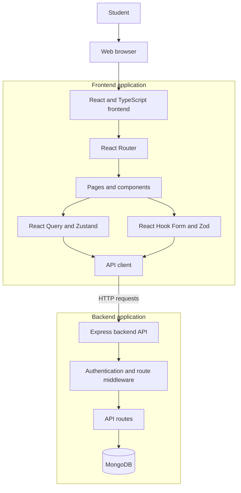

# Internship Application Tracker

[](https://github.com/jashiadeveza/itelect4-project/actions/workflows/ci.yml)

The Internship Application Tracker helps students organize internship applications and follow their progress. Users can manage applicant information, browse internship opportunities, and get AI-assisted internship reviews.

## Live Applications

- **Frontend:** https://itelect4-project-eight.vercel.app
- **Backend API:** https://itelect4-backend-topaz.vercel.app/

## Features

- User registration and login
- Dashboard for monitoring internship applications
- Internship opportunity browsing
- Applicant management and applicant details
- Protected pages for authenticated users
- AI-assisted internship reviews with strengths, improvement areas, and a fit recommendation

## Technology

- React and TypeScript
- Vite
- React Router
- TanStack Query
- React Hook Form and Zod
- Vitest and React Testing Library

## Architecture



The frontend is a Vite application. React Router selects the page, and the API client sends requests to the backend using `VITE_API_URL`. The backend handles API requests and database access.

## Run Locally

### Prerequisites

- Node.js 22 or later
- npm
- A running backend API, or access to the deployed backend

### Setup

Clone the frontend repository and install dependencies:

```bash
git clone https://github.com/jashiadeveza/itelect4-project.git
cd itelect4-project
npm ci
```

Create a `.env` file in the project root and set the backend URL:

```env
VITE_API_URL=http://localhost:3000
```

Use `http://localhost:3000` if you are running the backend locally. To use the deployed backend instead, set:

```env
VITE_API_URL=https://itelect4-backend-topaz.vercel.app
```

Start the development server:

```bash
npm run dev
```

Vite will print the local URL in the terminal, usually `http://localhost:5173`.

## Available Scripts

| Command | Description |
|---|---|
| `npm run dev` | Start the local development server |
| `npm run build` | Type-check and create a production build |
| `npm run typecheck` | Run the TypeScript checks |
| `npm test` | Run the test suite |
| `npm run test:watch` | Run tests in watch mode |
| `npm run lint` | Run ESLint |

## AI Use Disclosure

AI tools were used to assist with development and documentation tasks, including test setup and CI troubleshooting. The project authors are responsible for reviewing and validating the final changes.
